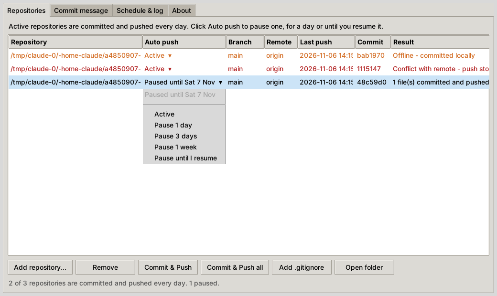
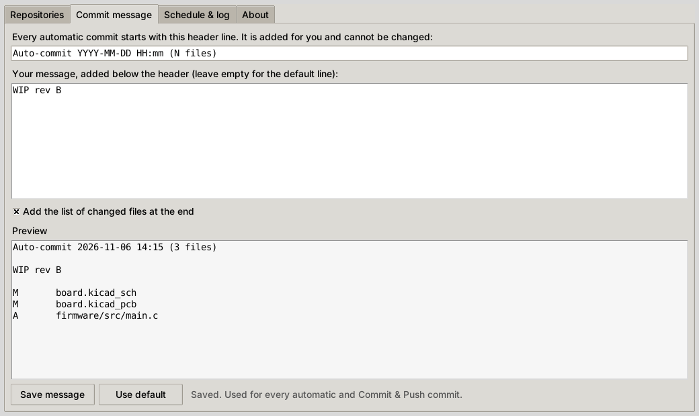
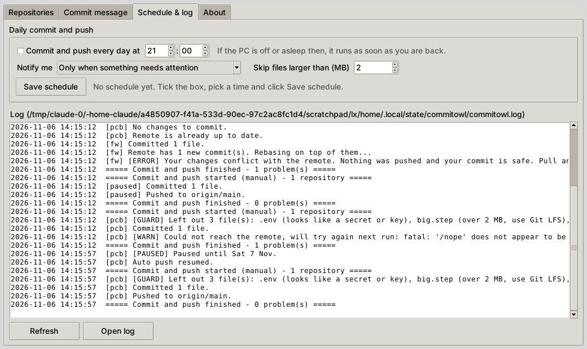

<p align="center">
  
</p>

<h1 align="center">CommitOwl</h1>

<p align="center">
  Daily auto commit and push for electronics projects, for Windows and Linux.<br>
  Developed by EMR Industries · Version 1.3 · MIT License
</p>

---

Once a day CommitOwl commits every change in your design repositories (KiCad, Altium, Eagle, firmware) and pushes it to the remote, so your schematics, layouts and firmware are backed up even on days you forget to commit. It works with git and any Git client you already use.



## Download and install

| | Download | Installation guide |
|---|---|---|
| **Windows** 10 / 11 | `CommitOwl-v1.3-windows.zip` from [Releases](../../releases/latest) | [windows/INSTALL.md](windows/INSTALL.md) |
| **Linux** (Ubuntu, Debian, Mint, Fedora, Arch...) | `CommitOwl-v1.3-linux.tar.gz` from [Releases](../../releases/latest) | [linux/INSTALL.md](linux/INSTALL.md) |

Both versions have the same features and use the same settings layout.

## Features

- **Daily commit and push** of every active repository at the time you choose. If the PC was off, it runs as soon as you're back.
- **Pause per repository**: for 1 day, 3 days, 1 week, or until you resume it.
- **Your own commit message** under a fixed `Auto-commit YYYY-MM-DD HH:mm (N files)` header, with an optional list of changed files.
- **Conflict alert**: if the remote changed the same files, it stops, keeps your work committed locally and tells you.
- **Safe by default**: never force-pushes, never asks for a password, never switches branches.
- **Guards**: secrets and keys, lock and temp files, and oversized files are never committed automatically.
- **Commit hash** of the latest commit for each repository, one double-click to copy.
- **Electronics `.gitignore`** template for KiCad, Altium, Eagle, PlatformIO, STM32CubeIDE and ESP-IDF.
- **Notifications** when something needs attention.

## What it does each day

For every active (not paused) repository:

1. Skips the repository if a merge or rebase is in progress, Git is busy, or the wrong branch is checked out.
2. Stages all changes, **including new files**, plus changed, renamed and deleted ones (`git add -A`). Files matched by `.gitignore` are skipped.
3. Leaves out secrets and keys (`.env`, `*.pem`, `*.key`, `wifi_secrets.h`...), lock and temp files (`*.lck`, `_autosave-*`, `~$*`), and files over the size limit (default 50 MB; files tracked by Git LFS are allowed).
4. Commits with the header **Auto-commit YYYY-MM-DD HH:mm (N files)**, then your message and the list of changed files.
5. Fetches the remote. New remote commits that don't touch your changes are handled by rebasing your commit on top. If the same files changed on both sides, it **stops** and shows *CommitOwl: auto commit stopped - conflict*.
6. Pushes, including any commits you made by hand but forgot to push.

If you're offline, the commit is still made locally and pushed on the next run.

## Using CommitOwl

### Repositories

| Button | What it does |
|---|---|
| Add repository... | Adds a repository, or turns a project folder into one (`git init`, remote URL, `.gitignore`) |
| Remove | Takes it off the list; the repository is not touched |
| Commit & Push | Commits all changes in the selected repository and pushes them now |
| Commit & Push all | Same, for every active repository (paused ones are skipped) |
| Add .gitignore | Adds the electronics rules, or the missing ones to an existing file |
| Open folder | Opens the repository in your file manager (double-clicking a row does the same) |

Click a repository's **Auto push** cell to pause it:

| Choice | Effect |
|---|---|
| Active | Committed and pushed every day |
| Pause 1 day | Skips today's push; back to normal tomorrow |
| Pause 3 days / Pause 1 week | Skips the daily push until then |
| Pause until I resume | Skips it until you set it back to **Active** |

A paused repository shows when it resumes (for example *Paused until Sat 7 Nov*), and its row is grey. **Last push**, **Commit** and **Result** show the outcome of the last run. Orange means committed locally but not pushed; red means it needs attention.

### Commit message



Type your message under the fixed header and click **Save message**. Leave it empty for the default line. **Preview** shows exactly what the commit will look like.

### Schedule & log



- **Commit and push every day at**: the daily time.
- **Notify me**: only when something needs attention (default), after every push, or never. A conflict is always notified unless this is **Never**.
- **Skip files larger than (MB)**: the size guard. GitHub refuses files over 100 MB.
- **Save schedule** creates or updates the daily job. Untick and save to turn it off.

### Command line (Linux)

```sh
commitowl                     # open the window
commitowl run                 # commit and push all active repositories now
commitowl run --repo ~/pcb    # one repository
commitowl schedule 21:00      # daily at 21:00
commitowl schedule off        # turn the daily run off
commitowl status              # repositories, pause state, last push and the schedule
```

## Where things are

| | Windows | Linux |
|---|---|---|
| Daily job | Task Scheduler: `\CommitOwl\Daily commit and push` | systemd user timer `commitowl.timer` (cron if systemd isn't available) |
| Settings | `%APPDATA%\CommitOwl\config.json` | `~/.config/commitowl/config.json` |
| Log | `%USERPROFILE%\commitowl.log` | `~/.local/state/commitowl/commitowl.log` |
| Notifications | Windows notifications | Desktop notifications (`notify-send`) |
| Built with | Windows PowerShell 5.1 + Windows Forms | Python 3 + Tk |

## Requirements

Each repository must be able to push **without a password prompt**:

- **HTTPS remotes**: push once by hand (`git push`) so your login is saved (Git Credential Manager on Windows, a credential helper on Linux).
- **SSH remotes**: an SSH key without a passphrase. On Linux, a key with a passphrase works for **Commit & Push** in the window, but not for the daily timer.

Windows also needs [Git for Windows](https://git-scm.com/download/win). Linux needs `git` and Tk for Python (`python3-tk`). The installation guides cover the details.

## Troubleshooting

| Log message | Fix |
|---|---|
| Push needs a login | Push once by hand (`git push`) so the login is saved |
| Git does not know your name and email | `git config --global user.name "Your Name"` and `git config --global user.email "you@example.com"` |
| Your changes conflict with the remote | Run `git pull`, resolve the conflict and commit. The next run pushes it |
| Left out N file(s) | Expected for secrets, lock files and big files. Add them to `.gitignore` to silence it, or use Git LFS for big CAD/3D files |
| Git was blocked (Windows) | Windows Security > Ransomware protection: allow `git.exe` and `ssh.exe` |
| No notification appears (Linux) | `sudo apt install libnotify-bin` |
| The window does not open (Linux) | `sudo apt install python3-tk` |

## Repository layout

```
CommitOwl/
├── README.md               this file
├── LICENSE                 MIT License
├── CHANGELOG.md            changes for both versions
├── assets/                 icon (ico, png, svg) and screenshots
├── electronics.gitignore   template used by Add .gitignore
├── windows/                PowerShell, .bat and .vbs files + INSTALL.md
├── linux/                  Python files, install.sh + INSTALL.md
└── tools/build-release.py  builds both release downloads into dist/
```

You can run either version straight from a clone: `windows\Start CommitOwl.bat` or `linux/start-commitowl.sh`. Both find the shared icon and template in the repository root.

## Making a release

1. Update the version in `windows/commitowl-common.ps1` (`$AppVersion`, `$AppBuildDate`), `linux/commitowl.py` (`APP_VERSION`, `APP_BUILD_DATE`) and the file headers.
2. Add the new version to `CHANGELOG.md`.
3. Build both downloads:
   ```sh
   python3 tools/build-release.py
   ```
   This creates `dist/CommitOwl-v<version>-windows.zip` and `dist/CommitOwl-v<version>-linux.tar.gz`. Each one contains the program, the icon, the `.gitignore` template, this README, the platform's INSTALL.md, the CHANGELOG and the LICENSE.
4. Commit, tag (for example `v1.4`) and push the tag.
5. On GitHub, create a release from the tag and attach both files.

## License

CommitOwl is free and open source under the [MIT License](LICENSE). You may use, copy, change and share it, as long as the copyright notice is kept.

Git is a trademark of its respective owner. CommitOwl is an independent tool by EMR Industries and is not affiliated with or endorsed by the Git project.

© 2026 EMR Industries
